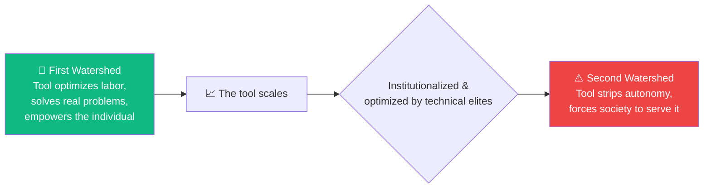
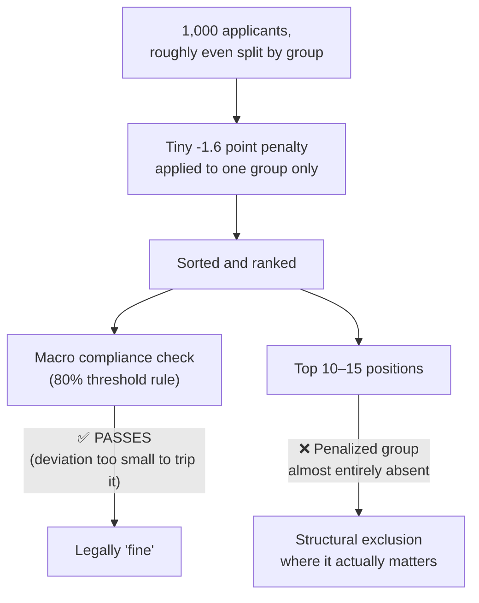

# Module 3: Algorithmic Systems & The Optimization Trap

## 📖 Core Readings This Week
* **Cathy O'Neil**, *Weapons of Math Destruction* (Chapters 1–3) — [Borrow via Internet Archive](https://archive.org/details/weaponsofmathdes0000onei)
* **Ivan Illich**, *Tools for Conviviality* (1973) — Chapter 1: "The Two Watersheds" — [Full text via Internet Archive](https://archive.org/details/toolsforconvivia0000illi)
* **Cracked Labs**, *Surveillance and Digital Control at Work* (2022–2024) — **choose one** report from the [project page](https://crackedlabs.org/en/data-work) and read it (options below)
* **Alkhathlan, Shrestha, Harrison & Rundensteiner**, *"Exploring 'Just Noticeable' Group Fairness in Rankings"* (AIES 2025) — [Official proceedings link](https://ojs.aaai.org/index.php/AIES/article/view/36532)

📚 Pick one Cracked Labs report

Each report looks at a different kind of workplace, so choose the one closest to your own experience or curiosity. You can read the report on its page; there's no need to download anything.

| Report | Focus | Length |
|---|---|---|
| [Surveillance and Algorithmic Control in the Call Center](https://crackedlabs.org/en/data-work/publications/callcenter) (May 2023) | Contact center software, automated management, outsourced work | 52 pp. |
| [Monitoring Work and Automating Task Allocation in Retail and Hospitality](https://crackedlabs.org/en/data-work/publications/retail-hospitality) (June 2023) | Monitoring and performance-control software in stores, restaurants, and hotels | 30 pp. |
| [Monitoring, Streamlining and Reorganizing Work with Digital Technology](https://crackedlabs.org/en/data-work/publications/processmining-algomanage) (Sept 2023) | Process mining, workflow automation, and AI built on detailed data about workers | 69 pp. |
| [Managing and Monitoring Mobile Service Workers via Smartphone App](https://crackedlabs.org/en/data-work/publications/mobilework) (July 2024) | Worker monitoring and algorithmic management in field service software | 35 pp. |
| [Employees as Risks](https://crackedlabs.org/en/data-work/publications/securityriskprofiling) (Aug 2024) | Behavioral profiling for cybersecurity, insider risk, and compliance | 76 pp. |
| [Tracking Indoor Location, Movement and Desk Occupancy in the Workplace](https://crackedlabs.org/en/data-work/publications/indoortracking) (Nov 2024) | Motion sensors and wireless networks used to monitor behavior in offices | 25 pp. |

---

## 🧠 1. Theoretical Context: The Second Watershed of Automated Management

We expand Cathy O'Neil's structural analysis of automated models by exploring how algorithms systematically reshape modern labor. Cracked Labs' *Surveillance and Digital Control at Work* project, carried out with partners including AlgorithmWatch, documents how companies collect and use detailed personal data about their employees through monitoring software, automated task allocation, and behavioral profiling. Automated decision-making (ADM) systems are now part of managing work in call centers, stores, hotels, offices, and field services.

To fully conceptualize this threat, we apply Ivan Illich's historical law of **The Two Watersheds**:

Modern optimization algorithms, predictive hiring platforms, and deep ranking models have crossed this Second Watershed. They no longer connect people or ease burdens; they function as invisible corporate managers that flatten human lives into optimized, un-auditable data matrices.

This manifests clearly in the ACM/AIES discovery of **"Just Noticeable" Bias** (Alkhathlan et al.). Optimization models rarely fail in catastrophic or obvious ways — instead, they introduce a penalty too small to trip a compliance check, but large enough to matter once concentrated at the top of a ranked list:

The penalty passes the legal test and fails the actual people affected — that gap is the whole point of "Just Noticeable" bias.

🔍 Go deeper: why this is genuinely hard to legislate against

It's tempting to think the fix is just "lower the compliance threshold"
or "check more carefully." But the 80% rule (or any similar
threshold-based test) has to draw a line somewhere, and wherever it
draws that line, a sufficiently small, sufficiently well-targeted
penalty can be built to sit just inside it. This isn't a loophole
regulators forgot to close — it's closer to a structural feature of
*any* threshold-based compliance test. Alkhathlan et al.'s contribution
isn't just "here's a bias," it's "here's a bias engineered to be
mathematically invisible to the exact kind of check the law actually
uses." That's a much harder problem than catching a one-off bad actor.

---

## 🛠️ Weekly Lab Evaluation Options

| | 💻 Developer Format | 🔍 Analyst Format |
|---|---|---|
| **What you do** | Build your own ranking simulation with a hidden penalty | Run the provided simulation and interpret its output |
| **Best for** | Students who want to construct the mechanism | Students who want to audit an existing one |
| **Deliverable** | Script + distribution graph | `LAB-SUBMISSION.md` with both test runs recorded |

### 💻 The Developer Format: The Just-Noticeable Ranking Audit
1. Write a script to simulate an institutional recruitment portal that ranks 1,000 applicants based on a synthetic performance score variable.
2. Introduce a hidden "Just Noticeable" loop: inject a minor 1.6-point performance-score penalty that targets candidates passing a non-protected proxy data point (e.g., graduated from a specific array of zip codes). This mirrors the penalty built into `labs/03-bias-simulation.html`, so your results should be directly comparable to the Analyst Format's.
3. **Deliverable:** Commit your script. Generate an output distribution graph showing how a standard, macro-level compliance audit completely misses this small deviation, while your timeline analysis proves the targeted demographic is entirely stripped of top-10 ranking positions by the end of the pipeline. Along with your script, include a short written reflection (a comment block or a brief companion `LAB-SUBMISSION.md`) connecting your results to Illich's Second Watershed and Alkhathlan et al.'s "Just Noticeable" bias findings — specifically, why a compliance check built around a single threshold number is structurally unable to catch a penalty engineered to stay just under it. In the same reflection, name the Cracked Labs report you chose to read, say what you read in it, and explain how it connects to the work of this module. Save your script, graph, and reflection together in a new folder named `modules/03-algorithmic-bias/` before you commit and push.

### 🔍 The Analyst Format: The Second Watershed Forensic Audit
1. Open `labs/03-bias-simulation.html` in your browser.
2. **Test Run 1:** Click the "Run Standard Baseline Array" button. Record the Disparate Impact Ratio and the output demographic distribution in the top 15 ranks.
3. **Test Run 2:** Click the "Deploy Opaque Optimization Model" button. Record the new Disparate Impact Ratio. Observe the Audit Compliance status box. Note the change in how many purple Group Beta candidates manage to retain placement flags inside the top 10 positions.
4. **Deliverable:** Create a new folder named `modules/03-algorithmic-bias/`. Copy [`LAB-SUBMISSION-TEMPLATE.md`](../LAB-SUBMISSION-TEMPLATE.md) into it, rename the copy `LAB-SUBMISSION.md`, and commit and push your audit analysis report there (the [Student Guide](../STUDENT-GUIDE.md) has the details). Using **Alkhathlan et al. (AIES)** and **Ivan Illich's Second Watershed criteria**, explain how the hidden 1.6-point reduction passes legal regulatory checklist formulas perfectly while completely executing structural exclusion at the pipeline's peak. Detail how this software has mutated from an empowering utility into an oppressive institutional monopoly. Also include a section naming the Cracked Labs report you chose to read, saying what you read in it, and explaining how it connects to the work of this module.
